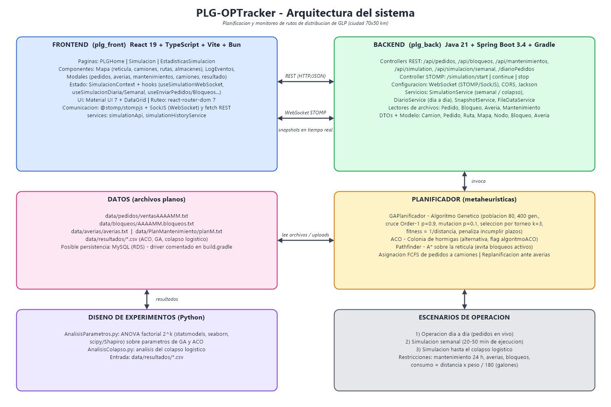

# PLG-OPTracker

Sistema de planificación y monitoreo de rutas para la distribución de GLP (gas licuado de petróleo) en una ciudad de 70×50 km. Planifica y replanifica las rutas de una flota de camiones cisterna respetando plazos de entrega, mantenimientos, averías y bloqueos de calles, y muestra la operación en un mapa en tiempo real.



## Qué hace
- **Tres escenarios:** operación día a día, simulación semanal y simulación hasta el colapso logístico.
- **Planificación:** algoritmo genético (con ACO como alternativa) que optimiza el orden de visita de cada camión, sobre distancias reales calculadas con A\*.
- **Visualización:** mapa de la retícula con camiones, rutas, almacenes y log de eventos.

## Stack
| Capa | Tecnologías |
|---|---|
| Backend (`plg_back`) | Java 21, Spring Boot 3.4, Spring Web (REST), WebSocket/STOMP, SSE, Gradle, Lombok |
| Frontend (`plg_front`) | React 19, TypeScript, Vite, Material UI, STOMP.js + SockJS |
| Análisis (`DiseñoExperimentos`) | Python: pandas, statsmodels, seaborn, scipy (ANOVA factorial) |

## Algoritmos
- **Genético:** población 80, 400 generaciones, selección por torneo (k=3), cruce Order-1 (0.9), mutación por intercambio (0.1), elitismo. Fitness = 1/distancia; las rutas que incumplen un plazo reciben fitness 0.
- **A\*:** camino mínimo sobre la retícula esquivando bloqueos activos.
- **ACO:** colonia de hormigas, seleccionable con `algoritmoACO`.

## Cómo ejecutarlo
Requisitos: Java 21 y Node 20+ (o Bun). No requiere base de datos: los datos salen de los archivos de `data/`.

```bash
# Backend (ejecutar desde plg_back: lee ../data)
cd plg_back
./gradlew bootRun            # http://localhost:8080

# Frontend
cd plg_front
npm install
npm run dev                  # http://localhost:5173
```

## Configuración
Nada sensible se versiona. Copia las plantillas `.env.example` y ajusta si hace falta:

| Variable | Dónde | Descripción |
|---|---|---|
| `VITE_API_URL` | `plg_front/.env.local` | URL del backend (por defecto `http://localhost:8080`) |
| `APP_CORS_ALLOWED_ORIGINS` | entorno del backend | Orígenes permitidos para REST y WebSocket |
| `SERVER_PORT`, `SERVER_ADDRESS` | entorno del backend | Puerto y dirección de escucha |

## Estructura
```
plg_back/            API REST + WebSocket, simulación y planificador
plg_front/           Interfaz web
data/                Pedidos, bloqueos, averías y plan de mantenimiento (entrada)
DiseñoExperimentos/  Scripts de análisis estadístico
docs/                Documentación y diagrama de arquitectura
```

## Flujo de datos
Archivos de `data/` (o subidos desde la UI) → `SimulationService`/`DiarioService` → planificador (GA + A\*) → snapshots por SSE (semanal) o WebSocket (diario) → mapa y log en el frontend.
